# sfui

Modular, high-performance UI suite, multi-account sync engine, and Classic/Camelot compendium for World of Warcraft (**Retail / Midnight 12.x** & **Classic / Camelot / Forever 1.15–1.60+**).

SFUI replaces bulky addon suites, complex WeakAuras, and fragmented utility addons with cohesive, lightweight native modules. Everything runs through a **unified event dispatcher** and shared core services — sleeping at zero CPU when idle, pooling high-frequency widgets to avoid garbage collection spikes, and maintaining strict combat taint and secret-value isolation.

---

## Architecture & Core Subsystems

- **Zero Combat Taint & Secret-Value Safety (`core/safety.lua`, `core/map.lua`)**: Secure action buttons, stance paging, radial rings, and override bindings are configured strictly out of combat. Blizzard secret values (`issecretvalue` on Midnight 12.x) are forwarded directly to native widgets without inspection, comparison, or `pcall` probing.
- **Unified Event Dispatcher & Reactive State (`dispatcher.lua`, `core/state.lua`, `core/module.lua`)**: Coalesces addon events, custom messages, lifecycle hooks (`sfui.RegisterModule`), and reactive pub/sub state updates with isolated module error boundaries.
- **Incremental Inventory & Equipment Index (`core/inventory.lua`)**: Single-pass dirty-bag tracker (`BAG_UPDATE` -> `BAG_UPDATE_DELAYED`) maintaining `O(1)` item counts, slot maps, equipped gear, and active quest items (`SFUI_INVENTORY_DELTA`, `SFUI_EQUIPMENT_DELTA`).
- **Quest Chain & Prerequisite Engine (`core/queststate.lua`)**: Evaluates live quest log state, completion flags, faction/race/class restrictions, and multi-step prerequisite chains across maps, trackers, and journals.
- **Protected Navigation & Deep-Linking (`core/navigation.lua`)**: Combat-safe World Map transitions (`C_Map.OpenWorldMap`), waypoint pins, and cross-module deep links connecting the Omnibox, Dungeon Journal, Recipe Browser, Fishing Atlas, and Alts Dashboard.
- **Centralized Tooltip & Modifier Hooks (`core/tooltips.lua`, `core/items.lua`)**: Unified tooltip post-processing for `Alt`-hover item/spell ID inspection, cross-alt bag/bank counts, recipe knowledge status, wishlist badges, and `Ctrl-Click` quick-open links for recipes and fish.
- **Frame & Texture Pooling (`core/pool.lua`, `core/widgets.lua`)**: Recycled widget and texture pools across tracked bars, cooldown icons, radial slices, objective blocks, and loot rows.
- **Cross-Era Spec & Talent Bridge (`core/bridge.lua`, `core/talents.lua`, `compat.lua`)**: Bidirectional specialization, role, and secondary stat weight resolution across Retail (`standard`) and Classic / Forever (`camelot`, `classic`).

---

## Features & Modules

### 1. Universal Omnibox & Command Palette (`/sffind`)
Instant, keyboard-driven search bar and launcher (`frames/find.lua`) connecting every subsystem in SFUI.

- **Unified Search Index (`/sffind [query]` or `/sf find [query]`)**: Searches SFUI option tabs, slash commands, saved layout profiles, dungeons & raids, bosses, encounter loot drops, dungeon quests, profession recipes, fishing species & waters, and synced/account alts in real time.
- **Direct Deep-Linking**: Press `Enter` or click any result to jump straight to an options tab, open a boss loot table or interactive dungeon map, inspect a recipe or fishing zone, switch layout profiles, or open an alt's inventory.

---

### 2. Radial Menu Engine (Quickdraw Rings)
Muscle-memory radial menus (`frames/ring/`). Hold a keybind to summon a ring at the cursor, flick toward a slice, and release to execute.

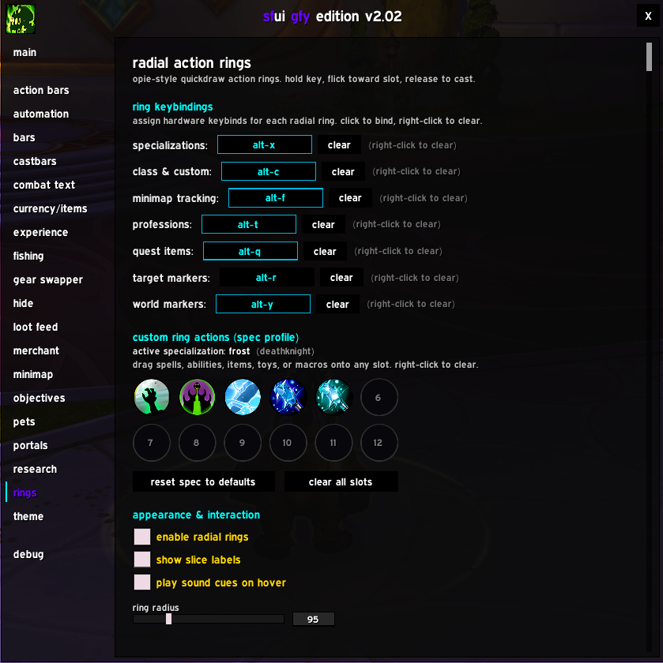

- **8 Dedicated Ring Providers (`/sfring` or `/sf ring`)**:
  - **Specializations (`ALT-X`)**: Instant specialization switching with active spec highlights.
  - **Class Utility & Custom (`ALT-C`)**: Class/spec utility spells, inventory items, collection toys, and custom macros with drag-and-drop slice editing.
  - **Smart Quest & Inventory Collectibles (`ALT-Q`)**: Auto-populated ring scanning bags for verified active quest items, weekly profession treatises, knowledge items, openable caches, key fragments, and uncollected toys, mounts, and pets.
  - **Minimap Tracking (`ALT-F`)**: Toggle gathering nodes, fish, repair, mailbox, and warband bank tracking without opening minimap menus.
  - **Professions (`ALT-T`)**: Quick-launch primary and secondary crafting skills and compendiums.
  - **Target Markers (`ALT-R`)**: Skull through star raid target assignment plus rapid clear.
  - **World Markers (`ALT-Y`)**: Ground flare placement and clearing.
  - **Hunter Pet Ring (`ring_pet.lua`)**: Dedicated pet call, mend, revive, dismiss, and utility ring on Camelot.
- **Deadzone Cancellation & Secure Execution**: Release inside the center deadzone or press `Escape` to cancel; executes spells, items, toys, and macros cleanly via secure attributes.

---

### 3. HUD, Unit Frames & Class Resource Bars
Clean, high-visibility unit frames and class bars (`frames/bars/`, `frames/experience/`) engineered for immediate combat readability.

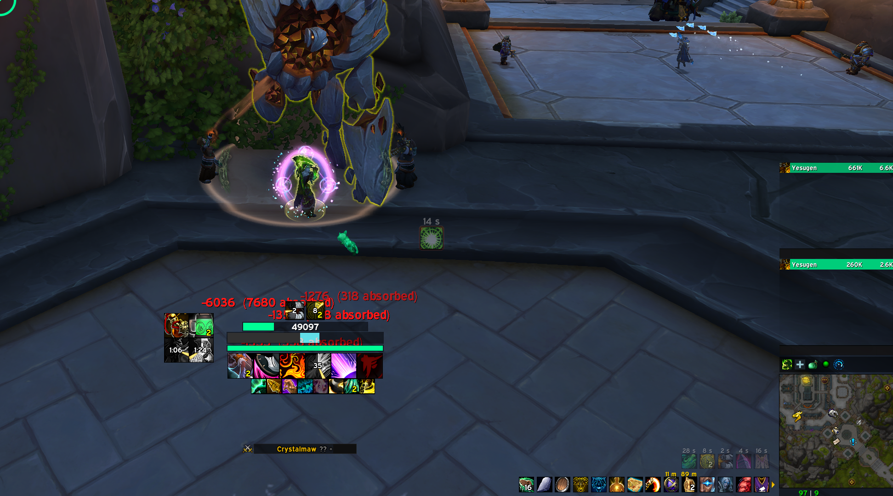

- **Unit Frames**: Player, target, focus, pet, and target-of-target frames with class colors, reaction borders, aura tracking, and secret-value safe updates.
- **Secondary Resource HUDs**: Combo points, runes, soul shards, arcane charges, holy power, essence, chi, **Monk Stagger** threshold meter, and Demon Hunter **Soul Fragments** bar (`soulfragments.lua`).
- **Classic & Camelot Combat Bars**: Precision **Weapon Swing Timer** (`swing.lua`), **Threat Meter** (`threat.lua`), movable **Shaman Totem Bar** (`/totembar`), and **Hunter/Warlock Pet Bar** (`pet.lua`).
- **Castbars**: Player and target castbars with channel ticks, empowered spell stages, interruptibility shields, latency indicators, and spell target names.
- **Progression Bar**: Experience bar with rested XP markers, quest turn-in XP prediction, Hunter pet XP, Camelot **Challenge Mode** status (`challenges.lua`), floating XP gains, and automatic reputation/renown/paragon switching at max level.

---

### 4. Action Bars, Quick-Keybind & Universal Movers
Low-overhead action bars (`frames/actionbars/`) with instant mouseover transitions, hover keybinding, and profile-backed layout management.

- **Action Bar Engine (Bars 1–6 & Pet Bar)**: Configurable button sizes, padding, columns, and throttled pet bar updates with native [Masque](https://www.curseforge.com/wow/addons/masque) skinning support.
- **Stance, Form & Skyriding Paging**: Seamless bar paging across Druid forms, Rogue stealth/shadow dance, Warrior stances, and Skyriding.
- **Hover Quick-Keybind Mode (`/kb` or `/keybind`)**: Bind keys and mouse buttons directly by hovering over any action button.
- **Universal Movers & Layout Profiles (`/sfmove`, `/sflock`, `/sf profile`)**: Unlock and reposition action bars, unit frames, tracked icon/bar panels, buffs, and HUD widgets with grid snapping, pixel-nudge arrows, form-sibling synchronization, named profile save/load (`/sf profile save <name>`, `/sf profile load <name>`), and multibox layout broadcasting (`/sf profile sync`).

---

### 5. Vehicle & Skyriding Interfaces
Combat-safe vehicle and flight HUDs (`frames/bars/vehicle.lua`).

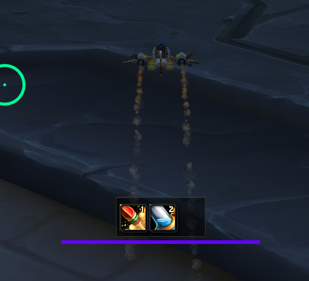

- **Liberated Vehicle Leave Button**: Unhooks `MainMenuBarVehicleLeaveButton` onto `UIParent` for independent positioning in `/sfmove` without main-bar lockups.
- **Seat & Skyriding Vigor HUD**: Passenger seat indicators plus a minimal vigor recharge and speed HUD for Skyriding / Dragonriding.

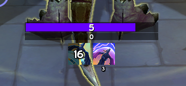

---

### 6. Cooldown Manager, Tracked Panels & Buff Reminders
Modular aura, cooldown, and missing-buff tracking (`frames/tracking/`, `frames/reminders/`) across Retail and Camelot.

- **Tracked Icon Panels (`trackedicons.lua`, `panels.lua`)**: Dedicated `CENTER`, `UTILITY`, `Left`, `Right`, class stance/form, and custom icon groups with multi-charge partial recovery edges, custom pixel/autocast glows (`glows.lua`), and Camelot multi-rank spell/seal resolution (`tracking_camelot.lua`).
- **Tracked Buffs Socket (`tracking/buffs.lua`, `trackedoptions.lua`)**: `SfuiTrackedBuffsSocket` and `buffs` configuration tab integrating seamlessly with Blizzard's `CooldownViewerSettings` and `BuffIconCooldownViewer` on both Retail and Forever without tainting viewer display data or secret M+ swipes.
- **Tracked Timer Bars (`trackedbars.lua`)**: Tabular-font (`NumberFontNormalSmall`) horizontal timer and stack bars with 30% **Pandemic** refresh sparks, dynamic threshold recoloring, and border glows.

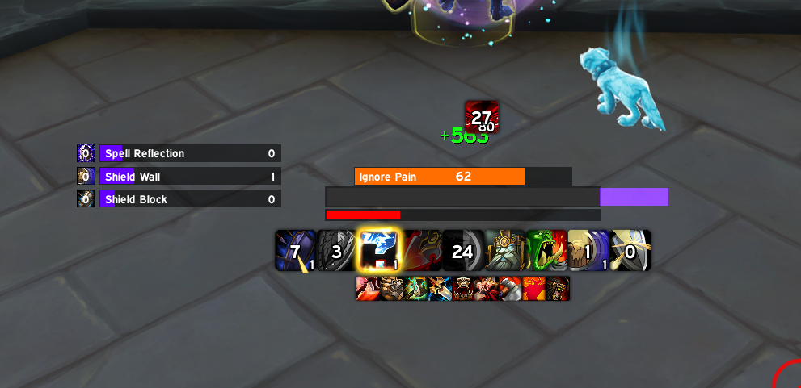

- **Raid, Party & Consumable Reminders (`frames/reminders/`)**: Event-driven (zero-`OnUpdate`) missing buff alerts for self buffs, weapon imbues/oils, food/flask consumables (`buffs_consumables.lua`), and smart role-aware **Paladin Party Blessing** reminders (`buffs_party.lua`).

---

### 7. Minimap & World Map Pin System
Crisp square minimap and extensible World Map pin providers (`frames/map/`).

- **Taint-Free Square Minimap (`/sf minimap`)**: Native square mask (`130937`) with `GetMinimapShape` compatibility, protected LibDBIcon/pin strata layering, indoor cave/delve handling, and clean queue/mail/location indicators.
- **Camelot World Map Pin Providers (`frames/map/providers/`)**:
  - **Dungeon Entrances & Prerequisite-Aware Quest Pins (`pins_dungeonjournal.lua`)**: Marks dungeon entrances and outside quest pickups, automatically resolving multi-step quest chains to their active starting prerequisite step.
  - **Recipe Vendors & Trainers (`pins_recipes.lua`)**: Pinpoints unlearned profession pattern sources with cross-alt filters.
  - **Library Books & Librarians (`pins_library.lua`)**: Tracks Camelot world library books and faction librarian turn-ins.
  - **Iconic Camelot Discoveries (`pins_camelot_quests.lua`)**: Step-by-step map guidance for the Cozy Sleeping Bag chain and Duskwood Night Watchman's Torch.

---

### 8. Objective Tracker, Mythic+, Delves & Shopping Lists
Streamlined quest, endgame, and crafting objective tracker (`frames/quests/`).

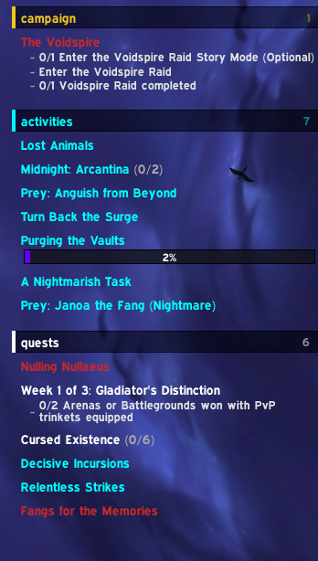

- **Modular Content Trackers**: Supports Campaign & World Quests, Scenarios, Achievements, Traveler's Log Activities, Collectables, Abundance & World Events, and Camelot Class/Skill/Challenge modules.
- **Mythic+ & Delve Boon Modules (`q_mythic.lua`, `q_boons.lua`)**: Compact Mythic+ keystone timer/affix display and The War Within Delve/Labyrinth boon stack monitor.
- **Secure Quest Item Buttons & Recipe Shopping Lists**: Embedded clickable quest items plus live reagent shopping lists (`Ctrl-Click` any tracked recipe to open it directly in the Recipe Browser).

---

### 9. Dungeon Journal, Interactive Maps, Recipes & Fishing Atlas (Classic / Camelot)
Full in-game compendiums bringing interactive maps, boss guides, crafting databases, and fishing logs to Classic and Forever clients.

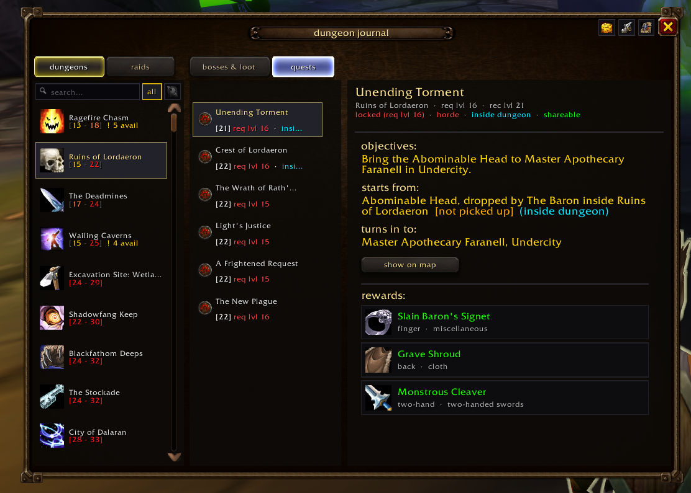

- **Camelot Dungeon Journal (`frames/dungeonjournal/`)**:
  - **Bosses, Loot & Wishlists**: Encounter mechanics, spec/armor-filtered loot tables, drop rates, and cross-character wishlist tagging.
  - **Interactive Multi-Floor Dungeon Maps (`dj_map.lua`)**: Zoomable, pannable dungeon maps featuring floor selectors, ladder transitions, hover traversal hints, clickable boss & quest-target portraits, quest objective pins, **Catmull-Rom Travel Route Guides** rendered directly onto the World Map, and an automatic **World Map (`M`) In-Dungeon Overlay** (with Scarlet Monastery wing tabs).
  - **Quest Chains & Share Helpers (`dj_quests.lua`)**: Faction-filtered dungeon quests displaying full prerequisite chains, active pickup locations, rewards, and party quest-sharing controls.

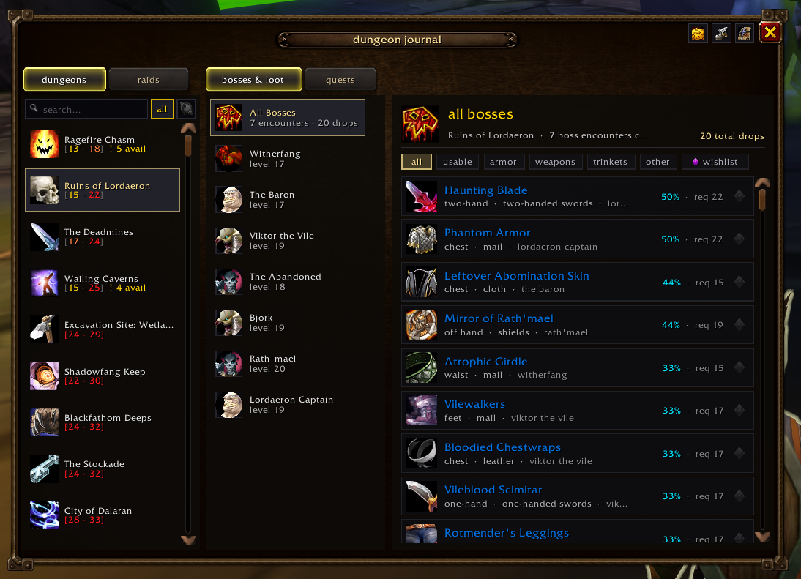

- **Recipe Catalogue (`/recipes` or `/sfrecipes`, `frames/professions/`)**: Searchable crafting compendium detailing materials, skill thresholds, trainers, vendors, drop sources, guild/friend **Crafter Contacts** (`contacts.lua`), and pinned reagent lists (`Ctrl-Click` recipe links to inspect).

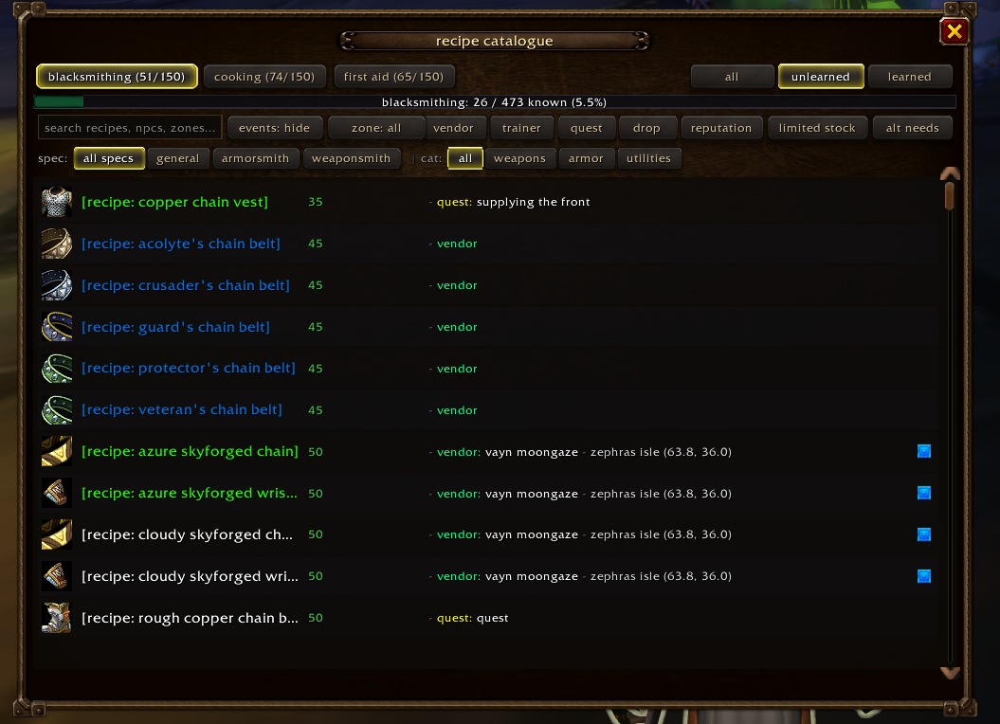

- **Fishing Atlas & Live Session HUD (`/fishing` or `/sffish`, `frames/fishing/`)**:
  - **3-Tab Fishing Atlas (`fishing_atlas.lua`)**: Searchable **Fish & Containers** catalog, **Waters** zone/skill breakdown across Kalimdor & Eastern Kingdoms, and personal **Logbook** catch records & trainer milestones (`Ctrl-Click` fish links to jump to species details).
  - **Live Fishing HUD (`/fishing hud`, `fishing_hud.lua`)**: Compact draggable session tracker showing catches per hour, zone species percentages, lure status, and skillups.

---

### 10. Multi-Account Sync & Multibox Coordinator
Built-in peer-to-peer synchronization and multibox party automation (`frames/sync/`).

- **Cross-Account Content Sync (`/sf sync`)**: Synchronizes alts, inventories, known recipes, crafter contacts, fishing records, wishlists, waypoints, and mail routing rules across accounts over `PARTY`/`RAID`, `WHISPER`, `GUILD`, and Battle.net GameData channels.
- **Multibox Party & Quest Automation (`multibox.lua`, `quests.lua`, `trade.lua`, `hud.lua`)**:
  - Rapid party formation (`/sf party`), leader handoff (`/sf lead`), synchronized `/reload` across clients (`/sf reloadall`), and pause/away mode (`/sf away`).
  - Auto-follow, flight-master taxi matching, automated trade routing, corpse alerts, and a compact peer status HUD.
  - Synchronized quest pickup and turn-in with **strictly advisory-only reward badges** — SFUI highlights upgrades on quest choices but never auto-selects or completes a quest when multiple item rewards are offered.

---

### 11. Loot Feed, Gear Upgrade Solver & Advisory Badges
Smart equipment evaluation, loot alerts, and quest reward scoring (`frames/gear/`, `frames/character/`).

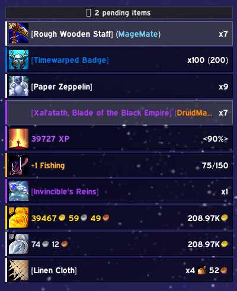
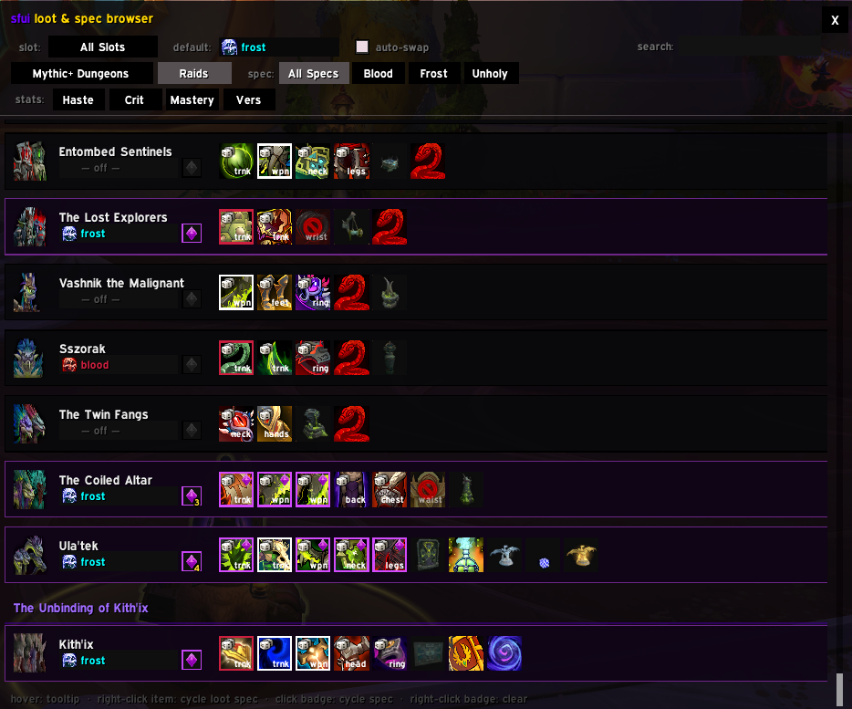

- **Loot Toast Feed & Encounter Browser (`lootfeed.lua`, `lootviewer.lua`)**: Clean toast notifications for items, currencies, rolls, and wishlisted group drops, plus Retail encounter loot browsing, bonus roll prompts (`bonusroll.lua`), and loot-spec reminders (`lootspec.lua`).
- **Role-Weighted Upgrade Solver (`frames/gear/highest/`)**: Evaluates bag equipment against preset or custom tank/healer/DPS stat weights with 1-click equip sets and Camelot Character Info stats (`infopanel.lua`).
- **Advisory Quest Upgrade Badges (Blizzard & DialogueUI)**: Displays upgrade percentage badges on quest reward choices in both native Blizzard Quest Frames and **DialogueUI** (Retail & Forever) without force-picking rewards.

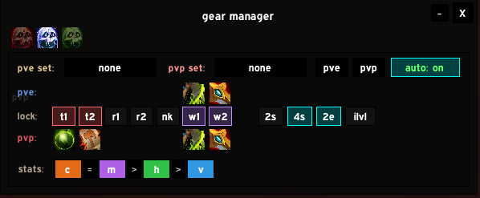
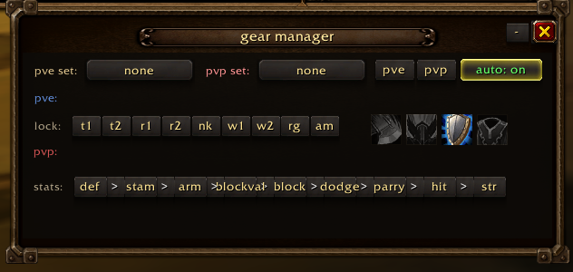

---

### 12. Merchant, Bag Triage & Economy Automation
Streamlined vendor, repair, and bag cleanup workflows (`frames/merchant/`, `frames/automation/`).

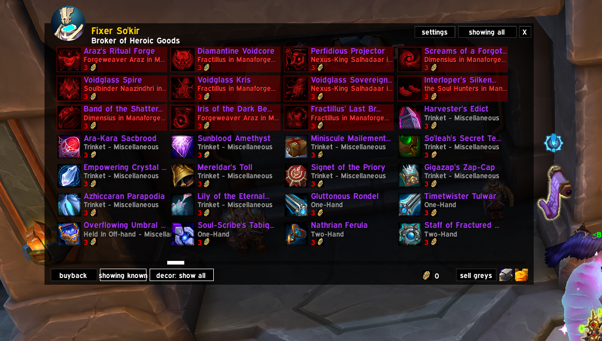

- **Auto-Sell, Auto-Repair & Merchant Filters (`merchant.lua`, `merchant_utility.lua`)**: Automated grey-junk sales with profit summaries, personal/guild repairs, stack-buy shortcuts, reagent restocking, and unlearned recipe highlights.
- **Bag Triage & Soul Shard Purge (`triage.lua`)**: Keybound item triage cleanup and Warlock excess Soul Shard culling (`/sfshards` or `/sf shards`).

---

### 13. Portals Hub
Unified teleportation and hearthstone popup (`frames/portals/`).

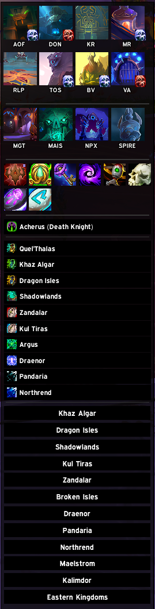

- **All-in-One Teleport Menu (`/portals` or `/sfportals`)**: Aggregates Hearthstones, Dalaran/Garrison Hearthstones, Mage teleports/portals, Mythic+ dungeon teleports, raid portal toys, and Engineering wormholes, dynamically filtered to unlocked destinations.

---

### 14. Alts, Warband & Automated Mail Dispatcher
Cross-character roster overview and rule-based mail routing (`frames/alts/`).

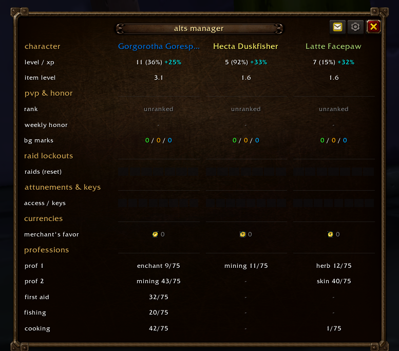

- **Account & Synced Roster Dashboard**: Inspect item levels, bags, banks, professions, lockouts, Great Vault progress, rested XP, gold, and currencies across every character and paired account.
- **Mail Dispatcher (`/sfmail` or `/altsmail`)**: Rule-based shipping engine (`mail_engine.lua`, `mail_mailbox.lua`) batch-sending reagents, BoEs, consumables, and materials to designated alts in one click, plus Retail currency transfer helpers (`transfer.lua`).

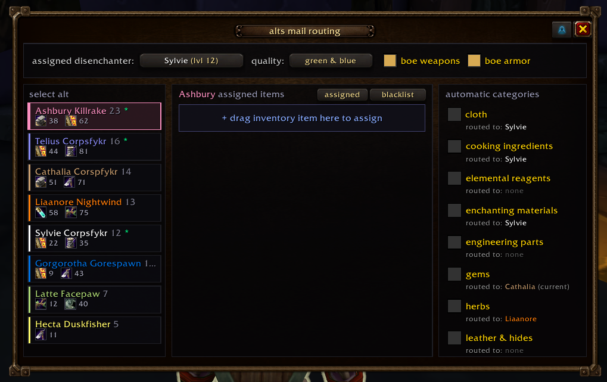

---

### 15. Quality of Life & Micro-Automations
Everyday conveniences (`frames/automation/`, `frames/research.lua`) that stay out of the way.

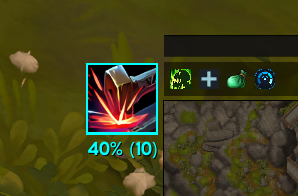

- **Master's Hammer Repair**: Instant Blacksmith repair popup when durability drops below threshold.
- **One-Key Fishing**: Single keybind to cast, apply lures, soft-target bobbers, and reel in.
- **Companion Pet Automation (`/sfpet`)**: Auto-resummons pets after dismounting with optional favorite rotation and Camelot pet management.

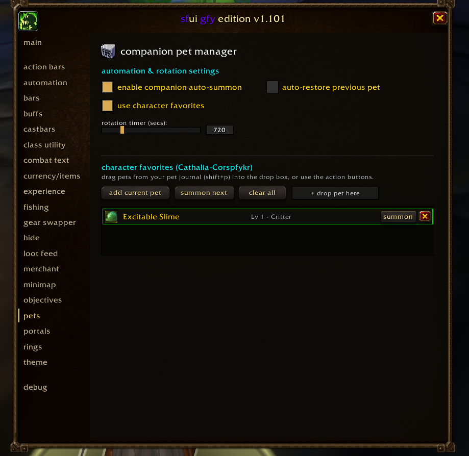

- **Trainer Spell Rank-Up (`rankup.lua`)**: Automatically upgrades action bar spells when higher ranks are learned on Classic/Camelot.
- **Order Hall & Research Monitor (`research.lua`)**: Tracks Retail research timers and talent completions.
- **Target Mount Matcher, Cinematic Skip & Tracking Micro-Bar**: Match your target's mount with one keybind, auto-skip watched cutscenes, and access consumables/trackers from the collapsible Tracking Manager.

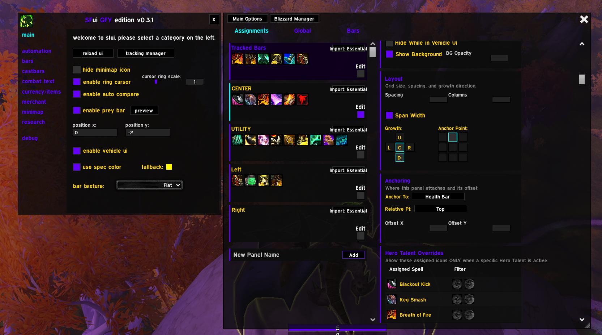

---

### 16. Driver-Based Theme Engine (6 Built-In Themes)
Live-switching visual theme system (`frames/themes/`) backed by weak-keyed widget registries for zero memory leaks.

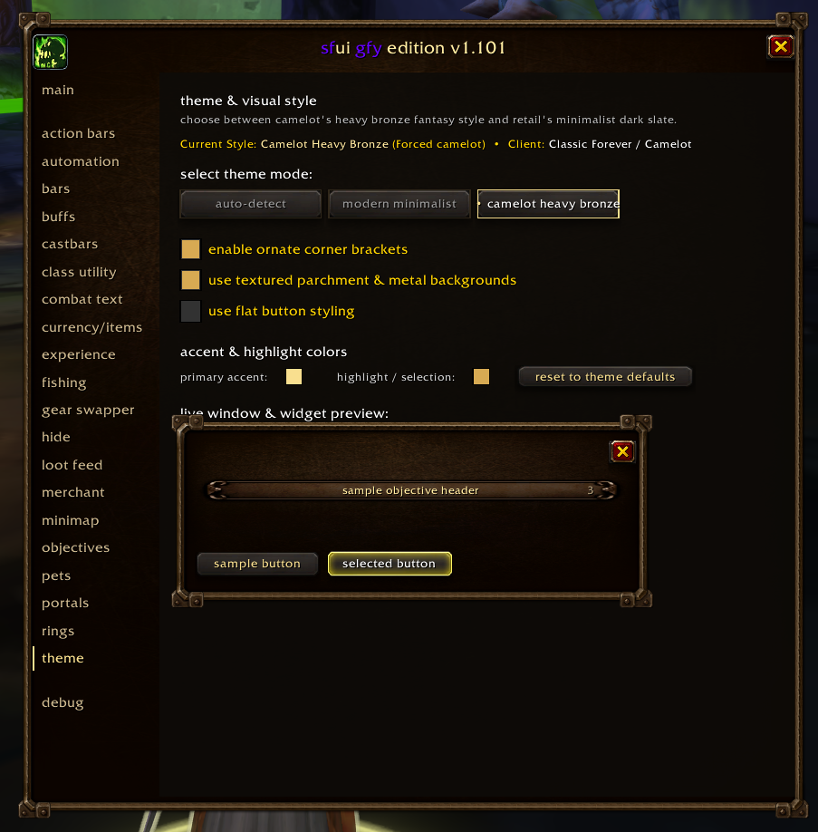

- **6 Selectable Themes (`/sftheme [mode]` or `/sf theme [mode]`)**:
  - **`modern`**: Minimalist flat dark-slate panels with crisp borders.
  - **`camelot`** (`bronze`): Authentic medieval parchment, bronze filigree borders, and period scrollbars (Classic / Camelot).
  - **`oldgod`**: Void-infused deep purple and eldritch gold accents.
  - **`fallensanctum`**: Shadowlands Torghast/Sanctum iron and soulfire styling.
  - **`maw`**: Charred stygian steel and ashen borders.
  - **`necrolord`**: Maldraxxus bone-plate and necrotic emerald accents.

---

### 17. Configuration, Memory & CPU Diagnostics

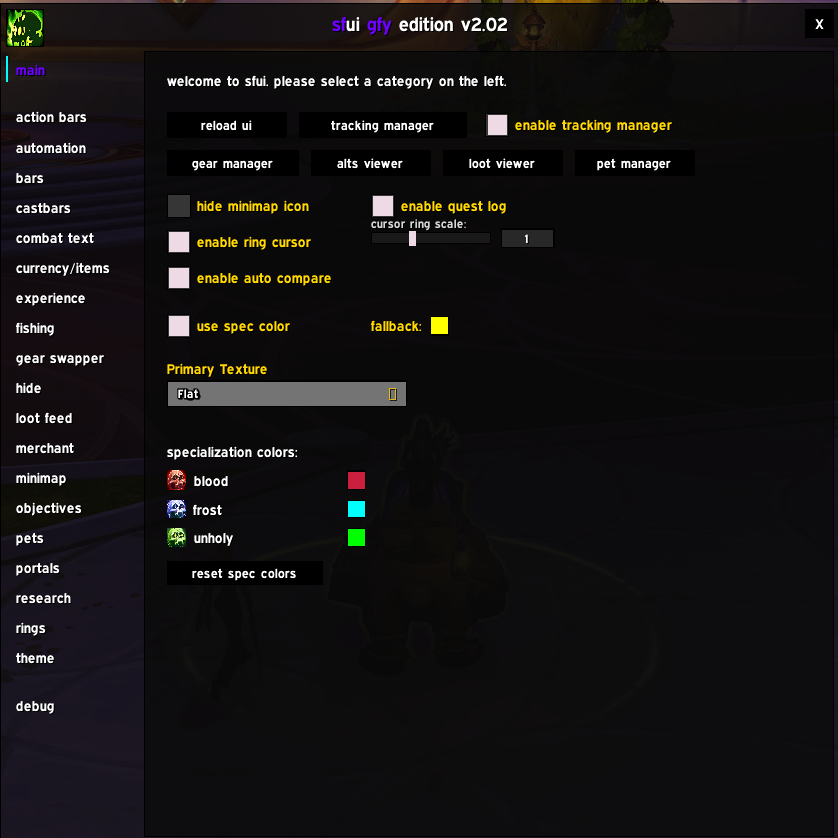

- **Tabbed Options Suite (`/sfui` or `/sf`)**: Unified settings window covering 25+ modules; jump straight to any tab via `/sf <tab>` (e.g. `/sf ring`, `/sf minimap`, `/sf sync`, `/sf buffs`, `/sf theme`).
- **Memory, Pool & CPU Profiler (`/sfmem`, `/sfcpu`)**: Real-time diagnostics (`frames/mem.lua`) reporting per-module memory usage, widget pool counts, garbage collection (`/sfmem gc`), timed CPU spike profiling (`/sfcpu [seconds]`), and `sfuibug` error log inspection (`/sf bug`).

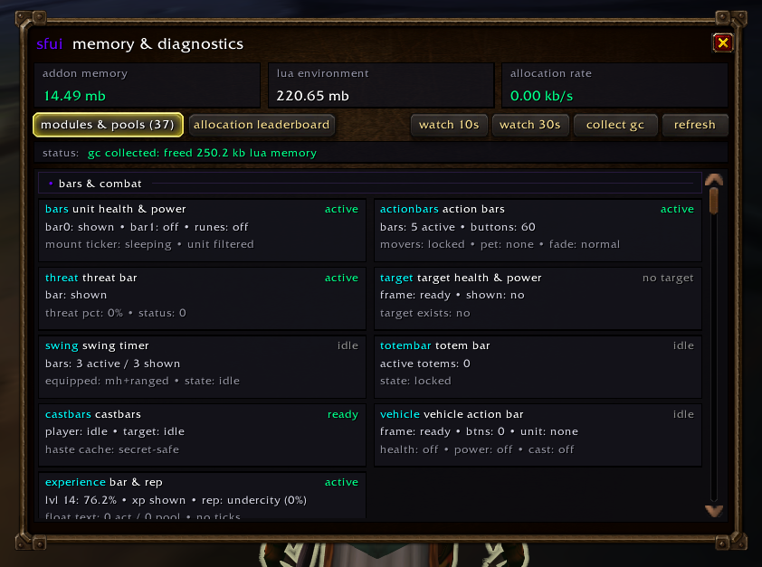

---

## Slash Commands

| Command | Action |
| :--- | :--- |
| `/sfui` or `/sf` | Open the main SFUI configuration panel |
| `/sf <tab>` | Open options directly to a tab (e.g. `/sf ring`, `/sf minimap`, `/sf bars`, `/sf sync`, `/sf buffs`, `/sf theme`) |
| `/sffind [query]` or `/sf find [query]` | Open the Universal Omnibox to search options, commands, dungeons, bosses, loot, quests, recipes, fish, and alts |
| `/sfmove`, `/sfedit`, or `/sf unlock` | Unlock UI movers for drag-and-drop positioning and pixel nudging (`/sflock` or `/sf lock` to lock) |
| `/sf profile <save\|load\|sync> [name]` | Save, switch, or broadcast named mover layout profiles |
| `/kb`, `/keybind`, or `/sfkeybind` | Toggle hover quick-keybind mode for action bars |
| `/sftheme [mode]` or `/sf theme [mode]` | Open theme settings or switch live between `modern`, `camelot`, `oldgod`, `fallensanctum`, `maw`, and `necrolord` |
| `/sfring [ring]` or `/sf ring [ring]` | Configure radial rings or open a specific ring (`target`, `world`, `prof`, `quest`, `track`) |
| `/portals` or `/sfportals` | Toggle the Portals & Hearthstones Hub |
| `/recipes [query]` or `/sfrecipes` | Open the Classic / Camelot Recipe Catalogue & Crafting Compendium |
| `/fishing` or `/sffish` | Open the Classic / Camelot Fishing Atlas (`/fishing hud`, `/fishing lock`, `/fishing reset`, `/fishing opt`) |
| `/sfmail` or `/altsmail` | Open the Alts Mail Dispatcher & routing rules configuration |
| `/sf sync [now\|party\|target\|name]` | Open Multibox Sync settings, pair characters, or broadcast state immediately |
| `/sf party` · `/sf lead` · `/sf away` · `/sf reloadall` | Form synced multibox party, request party lead, toggle away/pause, or reload all paired clients |
| `/totembar` or `/sftotems` | Toggle Shaman Totem Bar mover (Classic / Camelot) |
| `/sfshards` or `/sf shards` | Check and purge excess Warlock Soul Shards (Classic / Camelot) |
| `/sfpet` | Companion pet summon / rotation controls and options |
| `/sfmem` (`gc`) · `/sfcpu [seconds]` | Run memory/pool telemetry, force garbage collection, or profile CPU usage over a window |
| `/sf bug` | Inspect recorded addon errors when the `sfuibug` companion addon is loaded |
| `/rl` | Fast UI reload |

---

## Interactive Shortcuts & Keybindings

### Tooltip & Click Modifiers
- **`Alt` (Hover)**: Display Item IDs, Spell IDs, and extended cross-alt metadata in tooltips.
- **`Ctrl-Click` (Item / Recipe / Fish Link)**: Jump directly to the matching entry in the **Recipe Catalogue** or **Fishing Atlas** without conflicting with `Alt` ID inspection.

### Keybindings (`Game Menu -> Options -> Keybindings -> SFUI`)
- **Radial Rings**: Specializations (`ALT-X`), Class Utility & Custom (`ALT-C`), Minimap Tracking (`ALT-F`), Professions (`ALT-T`), Quest & Collectible Items (`ALT-Q`), Target Markers (`ALT-R`), World Markers (`ALT-Y`)
- **Dungeon Journal / Loot Browser**: Toggle the Camelot Dungeon Journal or Retail Encounter Loot Browser
- **Alts / Warband**: Toggle the cross-character roster & inventory dashboard
- **Portals**: Toggle the Portals & Hearthstones Hub
- **Cast & Catch Fishing**: One-key fishing cast, lure, and reel-in
- **Master's Hammer Repair**: Trigger instant Blacksmith repair popup
- **Match Target Mount**: Summon the exact mount ridden by your current target
- **Summon / Rotate Companion Pet**: Summon or cycle favorite vanity pets
- **Class Utility / Triage Delete (Classic / Camelot)**: Trigger class totem/shard utility or purge active triage item
