# sfui

Modular, high-performance UI suite and quality-of-life additions for World of Warcraft (Retail & Classic / Camelot / Forever).

SFUI replaces bulky addon suites, complex WeakAuras, and heavy frameworks with clean, lightweight native components. Everything is driven by a single **central event dispatcher** — instead of dozens of standalone addons running separate timers and eating CPU in the background, sfui coordinates all events and updates through one engine that sleeps when frames are idle and guarantees zero combat taint.

---

## Architecture & Design Principles

- **Zero Combat Taint**: Secure action buttons, stance paging, radial rings, and override bindings are configured out of combat and strictly isolated from protected Blizzard state during encounters.
- **Unified Event Dispatcher**: All module events are coalesced through a single throttled event hub (`dispatcher.lua`), eliminating redundant event registrations across frames.
- **Frame & Texture Pooling**: High-frequency elements (tracking bars, radial slices, objective items, loot rows) use pooled widgets with recycled textures to prevent memory churn and Lua garbage collection spikes.
- **Cross-Era Compatibility**: Decoupled multi-client support with native interfaces for Retail (The War Within / Midnight 12.x) and Classic (Camelot / Classic Era / Forever 1.15+).

---

## Features & Modules

### 1. Radial Menu Engine (Rings)
Quick-access radial menu system for instant, muscle-memory slice selection. Hold a keybind to summon the radial ring at your cursor, flick in the direction of the desired action, and release to cast.

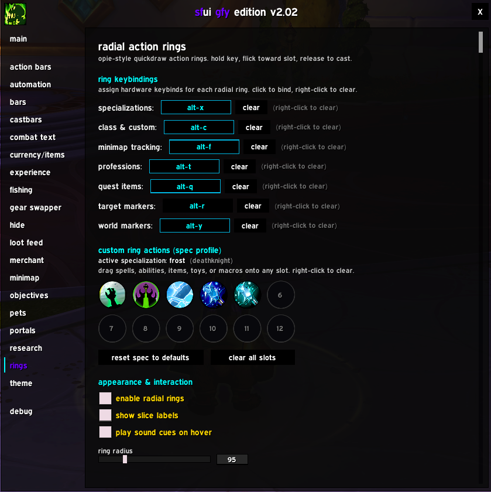

- **7 Dedicated Ring Providers**:
  - **Specializations (`ALT-X`)**: Instant class specialization switching with active spec indicators.
  - **Class Utility & Custom (`ALT-C`)**: Spec-specific utility spells, class abilities, inventory items, collection toys, and macros with interactive drag-and-drop customization in `/sfui ring`.
  - **Smart Quest & Inventory Collectibles (`ALT-Q`)**: Opie-style auto-inventory ring scanning bags for active quest items (strictly verified against the quest log), weekly inscription treatises, usable profession knowledge items, openable reward chests/caches, threshold key fragments, and uncollected toys, mounts, and battle pets.
  - **Tracking Options (`ALT-F`)**: Toggle tracking types (herbs, minerals, fish, repair, mail, warband bank) without digging through the minimap dropdown.
  - **Professions (`ALT-T`)**: Primary and secondary crafting and gathering trade skill windows.
  - **Target Markers (`ALT-R`)**: Rapid skull, cross, circle, star, square, moon, triangle, and diamond target markers with clear target option.
  - **World Markers (`ALT-Y`)**: Raid flare placement and clearing.
- **Deadzone Cancellation**: Release inside the center deadzone circle or hit Escape to abort without executing.
- **Secure Toy & Macro Execution**: Full support for collection toys via secure action attributes and `/use item:id` fallbacks, complete with cooldown spirals and desaturation.

---

### 2. HUD & Unit Resource Bars
Clean, modern unit frames and resource displays tailored for immediate combat clarity.

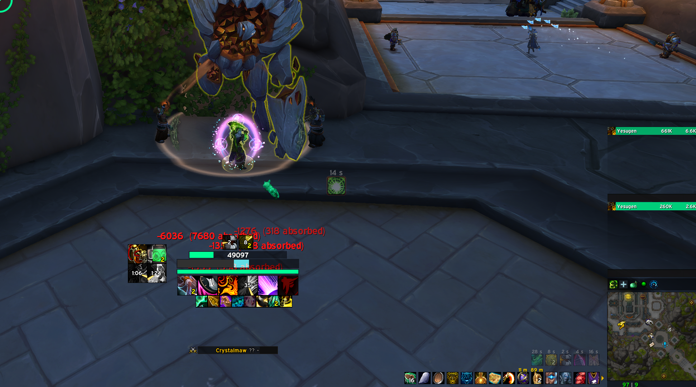

- **Unit Frames**: Player, target, focus, pet, and target-of-target frames with class colors, health percentage tags, and reaction borders.
- **Resource Bars**: Secondary power tracking for combo points, runes, soul shards, arcane charges, holy power, stagger, essence, and chi.
- **Monk Stagger HUD**: Continuous stagger meter with dynamic green/yellow/red threshold coloring and precise damage percentage readouts.
- **Castbars**: Player and target castbars featuring spell channel tick marks, empowered spell casting stages, interrupt shield indicators, and spell target names.
- **Progression Bar**: Experience bar with rested XP markers, quest turn-in prediction highlights, floating combat XP gains, and auto-switching to faction reputation, renown, or paragon progress at maximum level.

---

### 3. Action Bars & Combat HUD
High-performance action bar layouts built with sub-millisecond mouseover responsiveness and zero memory allocations during combat.

- **Action Bar Management**: Main bar, bottom-left, bottom-right, right bar 1, right bar 2, and pet bar with configurable button sizes, padding, and layout columns.
- **Stance & Form Paging**: Accurate class stance paging (Druid forms, Rogue stealth, Shadow dance, Skyriding flight page).
- **Pet Action Bar**: Throttled update pipeline decoupling cooldowns, usability, hotkeys, and auto-cast indicators to eliminate micro-stutter.
- **Mouseover Fading**: Instant, grid-cached alpha transitions on mouseover without per-slot database polling.
- **Button Skinning**: Seamless native integration with [Masque](https://www.curseforge.com/wow/addons/masque) (e.g. *Masque: Caith*).

---

### 4. Vehicle & Mount Interfaces
Combat-safe vehicle controls engineered to prevent UI lockups and seat desynchronization.

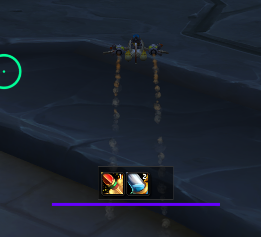

- **Liberated Vehicle Leave Button**: Default Blizzard vehicle exit button (`MainMenuBarVehicleLeaveButton`) cleanly unhooked from the main action bar and reparented to `UIParent`, positioned independently via `/sfui unlock`.
- **Seat Indicators**: Built-in integration with `VehicleSeatIndicator` and passenger seat tracking.
- **Skyriding / Dragonriding HUD**: Minimal vigor circle bar with recharge timers, speed indicators, and thrill-of-the-skies feedback.

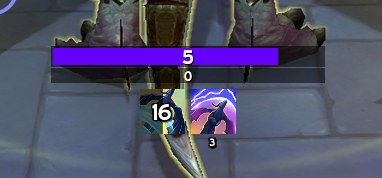

---

### 5. Cooldown & Aura Tracking
Comprehensive aura and cooldown visualization keeping vital buffs and rotational spells front and center.

- **Cooldown Manager (CDM)**: Dynamic spell cooldown viewer tracking active cooldowns, charges, and rotational availability.
- **Tracked Buff & Debuff Bars**: Horizontal timer bars for personal buffs, procs, and target debuffs with individual color customization.
- **Pandemic Glow & Spark**: Precise visual indicators for DoT/HoT refresh windows (Blizzard 30% pandemic threshold) with dynamic bar color transitions and border pixel glows.

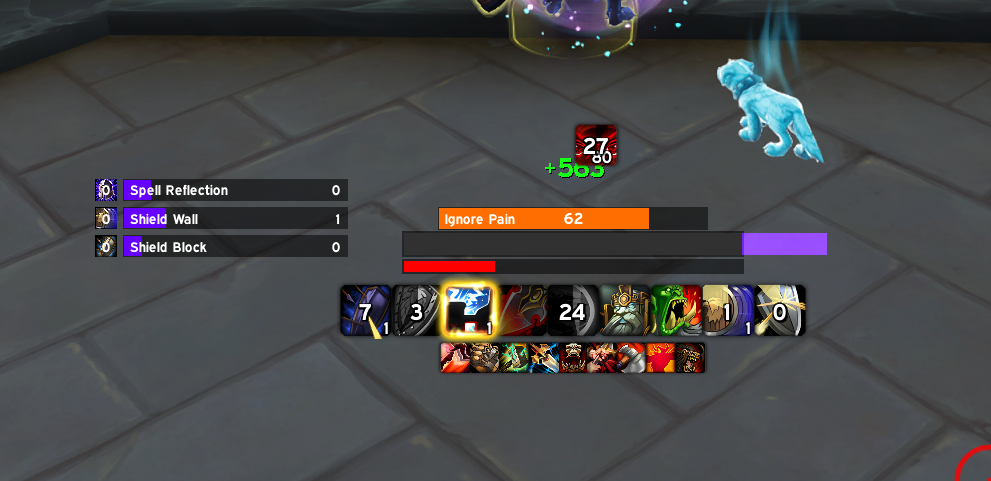

---

### 6. Minimap & Waypoint Navigation
Minimalist, high-performance square minimap designed for unhindered visibility and full addon compatibility.

- **Taint-Free Square Mask**: Engine-level square texture mask (`130937`) utilizing Blizzard's native shape APIs with global `GetMinimapShape` hooks for external addon pin placement.
- **Dimension & Position Customization**: Dedicated sliders for width, height, scale, anchor points, and screen offsets (`/sfui minimap`).
- **Icon Layering & Pin Styling**: Protected strata and level stacking ensuring addon icons (LibDBIcon), tracking pins, and quest indicators remain crisp and clickable above the map texture without occlusion.
- **Status Indicators**: Cleanly anchored queue status (dungeon finder) eye at the bottom-left and mail notification at the top-right.
- **Indoor Cave Map Support**: Seamless auto-handling for cave maps, delves, and indoor environments.

---

### 7. Delve & Labyrinth Boons Tracker
Dedicated power tracking panel for The War Within delves and labyrinth encounters.

- **Boon Monitoring**: Dynamic tracking for active delve powers, accumulated buff stacks, and stat augmentations (`1280098`).
- **Responsive Layout**: Automatically anchors below the delve scenario header and quest tracker with full tooltip inspection.

---

### 8. Objective Tracker & Shopping Lists
Streamlined quest and scenario tracking with integrated trade skill reagent management.

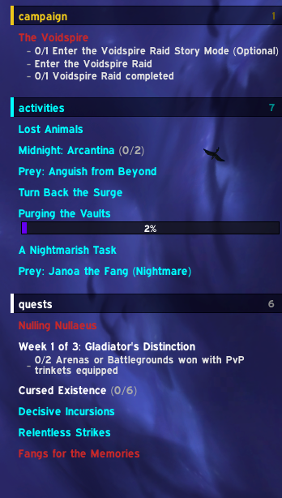

- **Clickable Quest Items**: Embedded action buttons alongside quest objectives for instant item usage without opening bags.
- **Recipe Shopping Lists**: Live reagent tracking pinned to the objective tracker, detailing required crafting materials and real-time in-bag counts.
- **Header & Section Collapse**: One-click toggles to minimize campaign quests, world quests, achievements, or scenario objectives.

---

### 9. Loot Feed, Encounters & Wishlists
Real-time loot alerts, roll management, and cross-character encounter drop tracking.

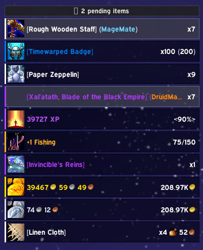

- **Loot Toast Feed**: Lightweight, non-intrusive loot toast feed tracking items, gold, currencies, and quest rewards.
- **Encounter Loot Browser**: In-game dungeon and raid encounter drop browser with spec-filtered loot views.
- **Cross-Character Wishlist**: Tag desired items across characters with automatic toast alerts whenever a wishlisted piece drops in your group or raid.
- **Auto-Comparison**: Automatic gear comparison integration for equippable drops in the loot feed.

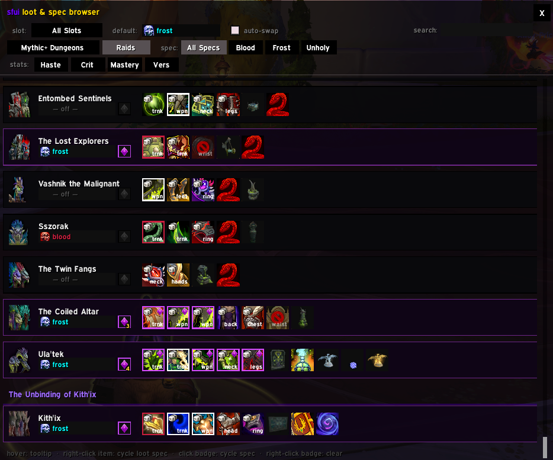

---

### 10. Gear Manager & Bag Upgrades
Smart inventory evaluation recommending optimal gear configurations.

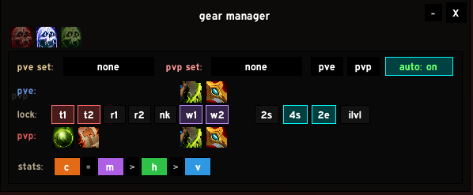

- **Bag Upgrade Analysis**: Automatic detection of higher item-level or better-itemized equipment sitting in your bags.
- **Role-Based Stat Weights**: Preset and custom secondary stat prioritization for tanks, healers, and DPS specializations.
- **Equipment Set Quick-Swap**: Rapid gear set swapping with keybind support.

---

### 11. Dungeon Journal & Recipe Catalogue (Classic / Camelot)
Full in-game reference databases bringing modern compendium tools to Classic and Camelot clients.

- **Classic Encounter Journal (`/dj`)**: In-depth boss tactics, ability descriptions, complete dungeon loot tables, and drop rates.
- **Recipe Catalogue (`/recipe`)**: Exhaustive crafting compendium detailing every profession recipe, required materials, trainer locations, vendor costs, and drop sources.
- **WorldMap Recipe & Entrance Pins**: Interactive map pins for dungeon entrances, quest pickups, and recipe vendors with cross-alt shopping lists.

---

### 12. Merchant & Economy Automation
Frictionless vendor interactions that save time on every town visit.

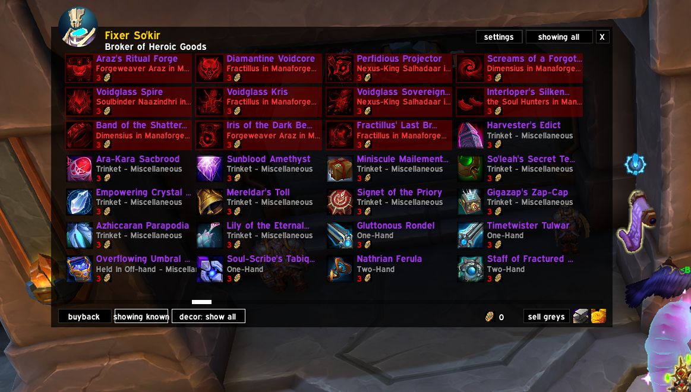

- **Junk Selling**: 1-click or automated sale of poor-quality (grey) items with detailed chat profit summaries.
- **Automated Repairs**: Instant gear repairs using personal funds or guild bank allowances.
- **Bulk Purchasing**: Shift-click shortcuts to buy exact stack quantities or maximum affordable amounts.
- **Recipe Knowledge Inspection**: Automatic highlighting of unlearned recipes on vendor lists.

---

### 13. Portals Hub
Consolidated teleport and hearthstone menu accessible anywhere in the world.

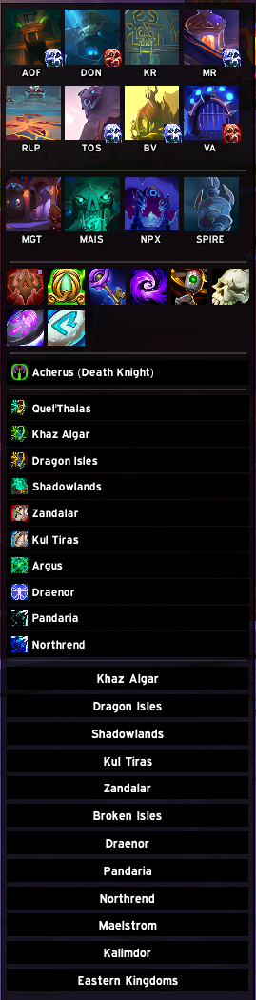

- **All-in-One Teleport Hub**: Instant popup listing standard Hearthstones, Dalaran/Garrison Hearthstones, Mythic+ dungeon teleports, raid portal toys, and engineer wormholes.
- **Dynamic Filtering**: Automatically hides destinations your character has not unlocked or cannot use.

---

### 14. Alts & Warband Dashboard
Cross-character overview keeping track of your entire roster at a glance.

- **Account Overview**: Track item levels, weekly dungeon lockouts, Great Vault progress, and rested XP across all characters.
- **Currency & Wealth Tracking**: Consolidated tally of gold, crests, valorstones, and holiday currencies across your Warband.
- **Profession Tracking**: Inspect known recipes, skill levels, and weekly knowledge points across alts without logging off.

---

### 15. Quality of Life & Automations
Thoughtful micro-features that eliminate repetitive manual tasks.

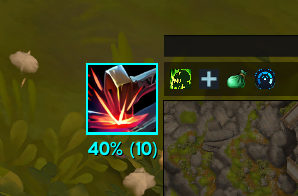

- **Master's Hammer Automation**: Instant Blacksmith Master's Hammer repair prompt when gear durability falls below safety thresholds.
- **One-Key Fishing**: Single keybind to cast and reel in, complete with soft-targeting and amplified splash audio.
- **Auto Companion Pet**: Automatically re-summons your companion pet after dismounting, with optional timed favorites rotation.
- **Spell Rank-Up**: Automatically replaces lower-rank abilities on your action bars when higher ranks are learned at trainers.
- **Cinematic & Movie Skipping**: Automatic skipping for watched cutscenes and talking-head dialogues.
- **Target Mount Matcher**: One-click keybind to summon the identical mount currently ridden by your target.
- **Tracking Manager**: Collapsible utility micro-bar for quick consumable, hearthstone, and tracker access.

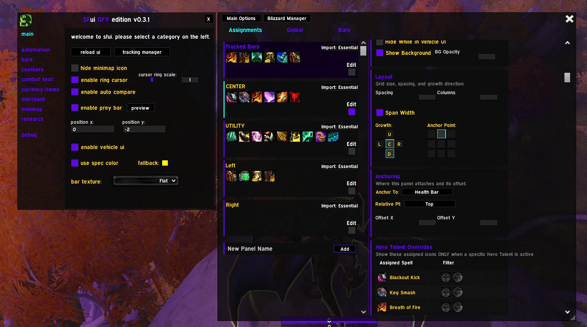

---

### 16. In-Game Configuration & Telemetry

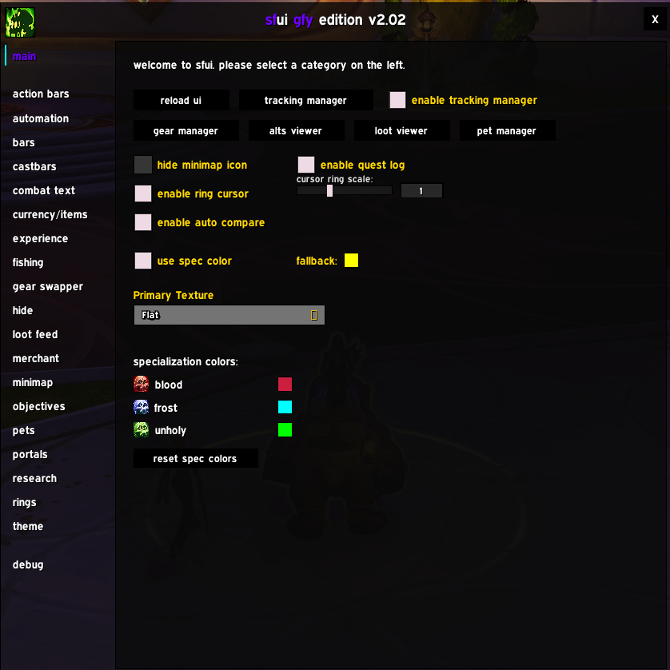

- **Options Panel (`/sfui`)**: Tabbed configuration suite covering all 18 subsystems. Jump directly to any section with `/sfui <tab>` (e.g. `/sfui ring`, `/sfui minimap`, `/sfui bars`, `/sfui trackedbars`).
- **Mover Mode (`/sfui unlock`)**: Intuitive drag-and-drop frame positioning with pixel-perfect nudge buttons and coordinate readouts.
- **Memory & Diagnostics Profiler (`/sfmem` or `/sfui mem`)**: Live telemetry dashboard tracking addon memory usage, CPU allocation rates, garbage collection cycles, and active subsystem states.

---

## Slash Commands

| Command | Action |
| :--- | :--- |
| `/sfui` | Open the main configuration panel |
| `/sfui <tab>` | Jump directly to a tab (e.g. `/sfui ring`, `/sfui minimap`, `/sfui bars`, `/sfui dj`) |
| `/sfui unlock` | Toggle frame movers to reposition UI elements |
| `/dj` or `/sfui dj` | Open the Classic / Camelot Dungeon Journal |
| `/recipe` or `/sfui recipes` | Open the Recipe Catalogue & Crafting Compendium |
| `/triage` or `/sfui triage` | Open the automated Bag Triage inventory manager |
| `/sfmem` | Open the real-time Memory & Diagnostics Profiler (`/sfmem gc` forces collection) |
| `/rl` | Fast UI reload |

---

## Keybindings

Configure keybindings under **Game Menu -> Options -> Keybindings -> SFUI**:

- **Radial Menus**: Specializations (`ALT-X`), Utility (`ALT-C`), Tracking (`ALT-F`), Professions (`ALT-T`), Quest Items (`ALT-Q`), Target Markers (`ALT-R`), World Markers (`ALT-Y`)
- **Cast & Catch Fishing**: One-key fishing cast and reel-in
- **Portals Hub**: Open the teleportation and hearthstone menu
- **Alts & Warband**: Open the cross-character roster dashboard
- **Loot Browser**: Open the encounter loot browser
- **Master's Hammer Repair**: Instant Blacksmith repair popup
- **Match Target Mount**: Summon the mount currently used by your target
- **Summon / Rotate Companion Pet**: Call or cycle active vanity pets
